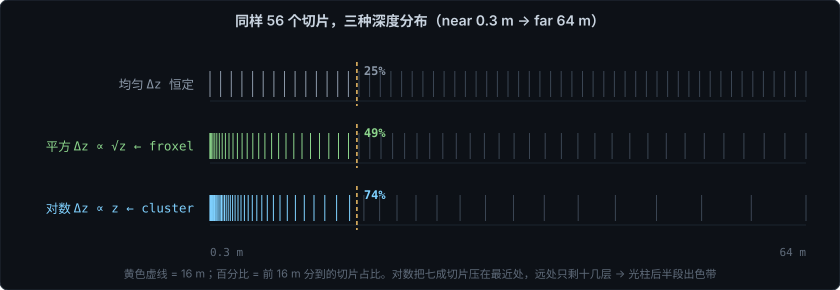
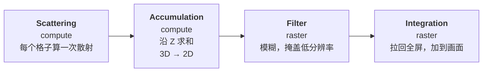

# Froxel：视锥体素

> Frustum + Voxel。体积光/体积雾的主流加速结构。
>
> 相关笔记：[Cluster 与 Z-Binning](<./Cluster与Z-Binning[视锥空间的光源剔除].md>) · [体积光](<./体积光[从ray-marching到froxel].md>) · [体积云](<./体积云[从噪声塑形到光学深度缓存].md>)

**可交互 demo → [在线打开](https://derkder.github.io/Graphics/assets/volumetric-light.html)**（拖滑块看相位函数 / 深度分布 / 色带与抖动 · [源码](../assets/volumetric-light.html)）

---

## 一、从逐像素 ray marching 的浪费说起

体积光最朴素的实现是：每个像素沿自己的视线步进 N 步，每步查一次阴影贴图，累加。

```
相机 ●──→ · · · · · · · ·   像素 (500, 300) 的 32 个采样点
     ●──→ · · · · · · · ·   像素 (501, 300) —— 几乎一模一样
     ●──→ · · · · · · · ·   像素 (502, 300) —— 还是几乎一样
     ... 共 200 万条视线
```

**相邻两条视线有多接近？**

60° 视角、1080 像素高，每个像素对应 0.055 度。在 10 米远处，相邻两个像素的采样点只差 **9 毫米**。

九毫米。空气的浑浊程度、是不是在阴影里，在这个尺度上几乎不可能有区别。**它们算出来的结果基本相同，但你付了两遍钱。**

放大看：一块 32×32 的像素区域，1024 个像素，在 10 米处它们的采样点全落在 31 厘米见方的范围里。**1024 个像素做了 1024 遍几乎相同的计算。**

这就是 froxel 要消灭的浪费。

---

## 二、核心思路：换一个组织维度

| | 组织方式 | 谁来算 |
|---|---|---|
| 逐像素 ray marching | **以视线为单位** | 我是像素，我沿我这条线走一遍 |
| Froxel | **以空间为单位** | 先把空间切成格子，每格只算一次，谁要谁来查 |

打个比方：

- 逐像素 = 一百万个人各自摸黑走同一条路，每人边走边自己测量
- Froxel = 先派测绘队把整片区域测一遍做成台账，之后所有人翻账本

**格子里存什么？** 存"这一小块空气朝摄像机方向散射了多少光"，也就是逐像素版循环体里算出来的那个值 —— 查完阴影、乘完相位函数之后的辐射亮度（RGB）。

---

## 三、为什么必须"跟着视锥切"

如果只是把空间切成盒子，那是普通体素（voxel）。froxel 多了一个关键设计：**网格跟着摄像机视锥走，横竖两个方向直接对齐屏幕**。

```
                          ┌──┬──┬──┬──┐
                  ┌───┬───┼──┼──┼──┼──┤
          ┌───┬───┤   │   │  │  │  │  │
  相机   ●┼───┼───┼───┼───┼──┼──┼──┼──┤
          └───┴───┤   │   │  │  │  │  │
                  └───┴───┼──┼──┼──┼──┤
                          └──┴──┴──┴──┘
```

这带来一个特别舒服的性质：

> **froxel 的 (x, y) 坐标 = 屏幕上的 (x, y) 像素块**

于是"每个像素把自己视线上经过的格子加起来"这件事，退化成"**把 3D 纹理的第 (x,y) 列沿 Z 加起来**" —— 一个 for 循环就完了：

```hlsl
// 累加 kernel 的全部核心逻辑
for (uint z = 0; z < FROXEL_COUNT_Z; ++z)
    accum += _ScatteringTexture.Load(int4(id.x, id.y, z, 0));
accum *= INV_SLICE_COUNT;
```

如果网格不跟视锥对齐（比如用世界空间的规则立方体网格），这一步就得为每个像素重新做射线求交，麻烦得多也慢得多。

---

## 四、算一笔账

1920×1080，一个 froxel 覆盖 32×32 像素、深度切 64 层：

```
逐像素版：  1920 × 1080 × 32 步  =  66,355,200 次
Froxel：     60  ×  34  × 64 层  =     130,560 次
                                    ─────────────
                                    便宜约 500 倍
```

**带宽的账更夸张**（这在移动端才是真正的瓶颈）：

| | 中间结果大小 |
|---|---|
| 全分辨率 RGBA16F 后处理 RT | 1920×1080×8 ≈ **16.6 MB** |
| Froxel 3D 纹理（60×34×64，RGBA16F） | ≈ **1.0 MB** |
| 累加后的 2D 纹理（60×34） | ≈ **16 KB** |

差了一个数量级还多。移动端 GPU 是 tile-based 架构，搬数据比算数据贵得多，这一条的价值不亚于 ALU 的节省。

> ⚠️ 但 compute shader **不走 tile 内存** —— 它没有 render pass 的概念，直接读写主显存。所以 froxel 是用"总量极小"换掉了"能待在片上"这个优势。在体积光这个场景里非常划算，换成全分辨率的 compute 后处理就要重新算账了。

---

## 五、深度分布：为什么不是对数

[Cluster 那篇](<./Cluster与Z-Binning[视锥空间的光源剔除].md>)里推导过，clustered shading 的深度分布用对数，因为要让格子保持各向同性、让包围球相交测试的假阳性最少。

**froxel 常见的做法却是平方分布：**

```hlsl
float depthEye = lerp(NEAR, MAX_DISTANCE, z01 * z01);   // z01 = sliceIndex / (sliceCount - 1)
```



厚度 `Δz ∝ √z`，比对数的 `Δz ∝ z` 温和得多。

按 `near = 0.3`、`maxDistance = 64`、56 层算，看前 16 米分到多少切片：

| 分布 | 前 16 米占的切片 |
|---|---|
| 均匀 | 25% |
| **平方** | **50%** |
| 对数 | 74% |

对数会把 74% 的切片压在前 16 米，只留 14 层给 16~64 米。**但光柱恰恰是横跨整个可见范围的大尺度结构** —— 远处那半段直接色带给你看。

### 两个原因

**一、优化的目标函数不同。**

| | Cluster | Froxel |
|---|---|---|
| 目标 | 剔除的假阳性率最低 | 积分精度匹配视觉重要性 |
| 约束来源 | 光源包围球是各向同性的 | 光柱是横跨全程的大尺度结构 |
| 最优分布 | 对数 | 介于均匀和对数之间 |

**二、动态范围差了一个量级。**

- Cluster 要覆盖 `0.3 → 1000` 米，比值 **3333**，不做激进压缩根本铺不开
- Froxel 已被 `maxDistance` 截断到 `0.3 → 64`，比值只有 **213**

**范围小得多，就不需要那么狠的压缩函数。**

> 平方分布不是什么定理，是针对特定截断距离和切片数调出来的工程选择。换个 maxDistance，最优指数就可能不一样。也有实现（包括 Frostbite 那篇体积雾论文，凭记忆，未核实）用指数型分布。

---

## 六、四个 Pass 的结构



### Pass 1 · Scattering

一次 dispatch，**一个线程负责一个格子**：

```hlsl
[numthreads(4, 4, 4)]     // 移动端 4×4×4，PC 常用 8×8×8
void ComputeLightScattering(uint3 id : SV_DispatchThreadID)
{
    // ① 索引 → 归一化坐标 → 世界坐标（这里用平方分布）
    float3 posCS = float3(id.x / (countX-1), id.y / (countY-1), id.z / (countZ-1));
    float  depthEye = lerp(NEAR, MAX_DIST, posCS.z * posCS.z);
    float3 posWS = EyeDepthToWorldPosition(depthEye, posCS.xy, fov, aspect);

    // ② 查阴影 + 相位函数（和逐像素版循环体一模一样）
    Light mainLight = GetMainLightWithShadow(posWS);
    float3 radiance = PhaseHG(mainLight, viewDir) * intensity;

    // ③ 写进 3D 纹理
    _ScatteringTexture[id] = float4(radiance, 1);
}
```

**和逐像素版的差别只有一处**：你在"视线上的第 i 步"算，它在"空间中的第 (x,y,z) 格"算。

线程组大小分平台是常见做法 —— 移动 GPU 的 wave/warp 更小，`8×8×8 = 512` 个线程一组往往占不满或寄存器压力过大，`4×4×4 = 64` 更贴合硬件。

### Pass 2 · Accumulation

沿 Z 求和，3D 压成 2D。就是第三节那段循环。

### Pass 3 · Filter

模糊，掩盖低分辨率带来的马赛克。见第八节。

### Pass 4 · Integration

拉回全屏叠加。**升采样可以白嫖硬件双线性**，不需要独立的 upsample pass：

```hlsl
// 用 LinearClamp 直接采低分辨率图，硬件插值顺手就把放大做了
float4 scattering = SAMPLE_TEXTURE2D_LOD(_AccumulationTexture, sampler_LinearClamp, uv, 0);
return float4(sceneColor + scattering.rgb, 1);
```

---

## 七、Froxel 与 Cluster 的关系

**同一个骨架，不同的器官。**

| | Cluster | Froxel |
|---|---|---|
| **算在哪** | CPU（Burst Job 之类） | GPU（compute shader） |
| **算在何时** | 帧最开头，任何 draw 之前 | 帧尾，透明之后、后处理之前 |
| **处理规模** | 几百盏灯 | 十几万个空间格子 |
| **格子里装什么** | 位掩码（**索引**） | RGB 辐射亮度（**结果**） |
| **是不是真 3D** | 不是，2D×1D 现场求交 | **是**，实打实的 3D 纹理 |
| **深度分布** | 对数 | 平方 |
| **读法** | 点查询，读 1 格 | **沿 Z 积分，读一整列** |
| **算糙了的后果** | 只是慢一点（多算几盏灯） | **画面直接出错**（色带、漏光） |

最后一行是本质区别，前面所有差异都由它推出：

- **Cluster 是加速结构**，粗一点无所谓 → 敢用有假阳性的近似换存储
- **Froxel 是结果本身**，糊一点画面就崩 → 必须建真 3D 纹理，还得配一堆精度补救措施

### 它们在同一行代码里相遇

froxel 的散射 kernel 要给每个格子算额外光源。上百盏灯 × 十几万格子 = 上千万次，不可能全遍历。

**于是它直接借用 cluster：**

```hlsl
InputData inputData = (InputData)0;
inputData.positionWS              = froxelPosWS;   // 这个格子的世界坐标
inputData.normalizedScreenSpaceUV = froxelPosCS.xy; // 这个格子对应的屏幕位置

LIGHT_LOOP_BEGIN(0)
    // 只遍历真正相关的那几盏灯
LIGHT_LOOP_END
```

这两行赋值就是喂给 `ClusterInit` 的原料 —— **一个 froxel 拿自己的位置去查 cluster，问"我这块空气该算哪几盏灯"。**

一帧里的完整链条：

```
[CPU] 帧开头
  └─ 算出 tile 掩码 + zBin 掩码 → 上传 constant buffer
──────────────────────────────────────────
[GPU]
  ├─ 阴影贴图
  ├─ 不透明物体着色     ← 用 cluster（点查询）
  ├─ 天空盒
  ├─ 透明物体着色       ← 用 cluster（点查询）
  ├─ HZB / AO ...
  ├─ ▶ Scattering      ← 填 froxel，内部对每个格子用 cluster
  ├─ ▶ Accumulation    ← 沿 Z 积分
  ├─ ▶ Filter          ← 模糊
  ├─ ▶ Integration     ← 叠加到画面
  └─ TAA / Bloom / Tonemapping
```

**Cluster 是地基，froxel 盖在它上面。** cluster 一帧只构建一次（还是在 CPU 空闲核心上），却被查询无数次 —— 每个着色像素一次，每个 froxel 也一次。这个"一次构建、全帧复用"的性价比就是它存在的理由。

---

## 八、代价，以及补救措施

froxel 把总量降下来了，但**它同时制造了一批新问题**。工程实现里的大部分复杂度都花在补救上。

| 新问题 | 成因 | 常见补救 |
|---|---|---|
| 横向马赛克 | 一格覆盖 32×32 像素 | 多尺度模糊金字塔 |
| 物体边缘硬边 | 深度测试在低分辨率下是 32 像素的锯齿 | **软深度测试**（渐变代替 0/1） |
| 深度方向色带 | 切片数有限 | 平方分布 + 近处分档多采样 |
| 远处失真 | 远处一格覆盖几十米 | 截断 `maxDistance` |

### 软深度测试

被场景物体挡住的格子不该发光。朴素写法是硬判断：

```hlsl
float mask = sceneDepthEye > froxelDepthEye ? 1 : 0;   // ❌ 边缘出现 32 像素的硬锯齿
```

改成渐变：

```hlsl
float mask = saturate((sceneDepthEye - froxelDepthEye) / depthBias);   // ✅
```

在深度差很小的地方平滑淡出，顺带治地面上的 banding 和 acne。

**逐像素全分辨率版本根本不会遇到这个问题** —— 它是低分辨率带来的次生问题。

### 近处分档多采样

平方分布还不够，最近那批切片仍然容易出色带。常见做法是按深度分档：

```hlsl
int sampleCount = 1;
if      (id.z < closeSliceCount)     sampleCount = 4;
else if (id.z < closeSliceCount * 2) sampleCount = 3;
else if (id.z < closeSliceCount * 3) sampleCount = 2;

for (int i = 0; i < sampleCount; ++i)
{
    // zIndexBias 在格子内部沿深度错开
    Froxel f = ComputeFroxel(id, i / (float)sampleCount);
    scattering += ...;
}
```

56 层一列实际采 `16×4 + 16×3 + 16×2 + 8×1 = 152` 次。

**这是花钱不是省钱** —— 比每格采一次贵 2.7 倍。但对比"全部采 4 次"（224 次）又省了三分之一，画质几乎没区别。**它省的是"花在看不见的地方的钱"。**

### 多尺度模糊金字塔

比单次高斯更好的做法：逐级降采样模糊到 1/16，然后多级等权混合。

```
full → 1/2 → 1/4 → 1/8 → 1/16
  └────┴─────┴─────┴──────┘
        等权重混合
```

单次模糊做不出这个效果：要么保住细节但糊不干净，要么糊干净但光柱变成一坨。金字塔让高分辨率层保住细结构，低分辨率层贡献一圈柔和辉光。

好在这几张图都很小，多次 blit 的带宽开销可忽略 —— 这是低分辨率的红利。

---

## 九、一句话总结

**Froxel 是把"沿视线积分"重组成"在空间中预计算 + 沿一列求和"，用相邻像素之间的巨大冗余换来两个数量级的成本下降。**

它和 cluster 共享同一套视锥网格结构，但因为装的是**结果**而不是**索引**，精度要求完全不同 —— 所以需要平方分布、软深度测试、分档多采样、多尺度模糊这一整套补救措施。

学习路径上建议先亲手写一遍[逐像素版](<./体积光[从ray-marching到froxel].md>)，把色带和性能问题都撞一遍，再看 froxel 会顺很多。
