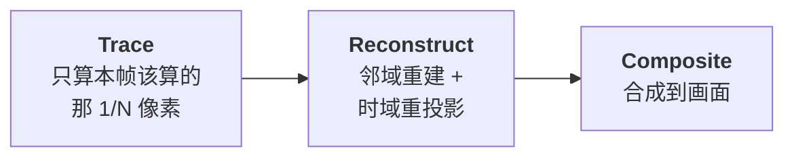

# 体积云：从噪声塑形到光学深度缓存

> 相关笔记：[体积光](<./体积光[从ray-marching到froxel].md>) · [Froxel](<./Froxel[视锥体素·体积光的加速结构].md>) · [Cluster 与 Z-Binning](<./Cluster与Z-Binning[视锥空间的光源剔除].md>)

---

## 一、云和体积光是同一个方程的两半

先把结论摆前面，因为它决定了后面所有内容的组织方式。

**体积渲染方程**沿一条视线积分，每走一小段 `Δs` 做两件事：

```
① 这段吸收/散射掉多少光  →  透射率  T *= exp(−密度 × Δs)
② 这段往我眼睛散射多少光  →  累加   += 光照 × 密度 × Δs × T × 相位函数
```

**体积光和体积云解的是同一个方程。** 区别只在于「密度」和「光照」这两项怎么来：

|  | 密度从哪来 | 光照从哪来 |
|---|---|---|
| **体积光** | 常数 / 简单高度雾 | 阴影贴图（**二值**：照到 / 没照到） |
| **体积云** | 3D 噪声塑形出的云团（**变化剧烈**） | 再 march 一次（**连续**的光学深度） |

**体积光是体积云的退化情形** —— 它在密度和光照两个维度上都做了极端简化，所以便宜一个量级。

反过来看：一旦密度不再是常数、光照不再是二值，成本立刻爆炸。这就是云贵的全部原因。

---

## 二、云的密度：用噪声「雕」出来

云的形状不是建模出来的。整个流程是层层相乘/相减：

```
① 2D 天气图 (weather map)        → 哪里有云、云层多厚、降水强度
② 高度剖面 (height profile)      → 这个高度该是什么形状（底部平、顶部蓬松）
③ 低频 3D 噪声（Perlin-Worley）  → 大团块轮廓
④ 高频 3D 细节噪声（做减法侵蚀） → 边缘的絮状感
```

典型尺寸是低频 128³、细节 32³，两张都是 tileable 的 3D 纹理。

### 为什么细节噪声是「减法」

这一点容易写反。细节噪声不是加上去的，是**从基础形状的边缘往里侵蚀**：

```hlsl
float base = SampleBaseNoise(p) * heightProfile * coverage;
float detail = SampleDetailNoise(p);

// 侵蚀：只在密度低的边缘区域起作用，核心区域几乎不动
density = Remap(base, detail * erosionStrength, 1.0, 0.0, 1.0);
```

加法会让云变成一团糊；减法才能做出边缘那种撕扯开的絮状轮廓。

> 这套「天气图 × 高度剖面 × 基础噪声 − 细节噪声」的流程，是 Guerrilla 在 *Horizon Zero Dawn* 上提出的 **Nubis** 方案（SIGGRAPH 2015/2017 有公开分享）。现在基本是行业默认做法。

---

## 三、云的光照：贵在嵌套循环

这是云和体积光最本质的分野。

**体积光问的是**：这一点被照到吗？
→ 查一次 shadow map，**一次纹理采样**，答案是 0 或 1。

**云问的是**：阳光穿过多少云才到这一点？
→ 答案是连续值，朴素做法是**从这一点再往太阳方向 march 一遍**：

```
主视线 march  128 步
  └─ 每一步再往太阳 march  6~10 步
     ────────────────────────────────
     768 ~ 1280 次密度采样 / 每像素
```

**体积光是单层循环 + 一次查表；体积云是嵌套循环。** 后面所有优化，本质上都在对付这个嵌套。

---

## 四、五类优化

按砍掉的成本排序。

### 1. 光学深度缓存 —— 把嵌套循环拍平

最漂亮的一手：不再逐点向太阳 march，而是预先算一张**世界空间 3D 纹理**，存「这个位置到太阳的光学深度」。

```
典型规格：128 × 128 × 16 的 3D 纹理
更新策略：每帧只重建 2 层，8 帧摊完一轮（amortized）
```

主循环里那一层向光 march，就变成了一次 3D 纹理采样：

```hlsl
// 优化前：嵌套 march
float od = 0;
for (int i = 0; i < lightSteps; ++i)
    od += SampleCloudDensity(p + sunDir * i * lightStep) * lightStep;

// 优化后：查表
float od = SAMPLE_TEXTURE3D(_DirectionalODCache, sampler_linear, WorldToCacheUVW(p)).r;
```

**这一步把 O(主步数 × 光步数) 降成 O(主步数)。**

> ⚠️ 有个隐蔽的前置约束：缓存和主视线**必须看到同一片云**。密度域的所有参数（噪声频率、域扭曲幅度、天气图偏移……）两边要严格同步，否则光照会和形状对不上——云在这里，阴影在那里。
>
> 实现里通常会把这些参数集中成一个结构体，两边共用，避免手动同步出错。

### 2. 粗/细两级自适应步进

云在天空中占比很小，**绝大部分射线路程是空气**。所以用状态机在两种步长之间切换：

```
COARSE 模式（大步跳）：
   ├─ 先问「这一大块里可能有云吗」（查低分辨率的覆盖信息）
   ├─ 没有 → 整块跳过
   └─ 可能有 → 切 FINE

FINE 模式（小步走，正常积分）：
   └─ 连续 N 步密度都是 0 → 切回 COARSE
```

配套三条常见收尾：

| 手段 | 作用 |
|---|---|
| **硬性 cell 预算** | 按画质档给上限（如 128 / 192 / 256），耗尽时步长变大但不截断远端 |
| **透射率提前退出** | `T < 阈值` 就 break —— 云背后已经看不见了 |
| **步长随距离增长** | `step = clamp(base + dist × slope, base, farStep)` |

第三条和 froxel 的**平方分布深度切片是同一个思路**：远处精度需求本来就低。

### 3. 时域重建：每帧只算一小部分

砍得最狠的一刀。

**每帧只追踪 1/N 的像素**（常见 N = 4 或 16），用 Bayer 序列轮转相位，N 帧凑齐一轮完整覆盖，中间靠时域重投影补齐。

典型的三段式 Pass 结构：



历史帧不能无脑混合，否则云动/相机动的时候就是拖影。标准做法是**邻域夹持 + 误差拒绝**：

```hlsl
float4 clamped = clamp(historySample, neighborMin, neighborMax);
float error = MaxComponent(abs(historySample - clamped));
if (error > rejectThreshold)
    return currentSample;          // 历史不可信，直接丢弃
return lerp(currentSample, clamped, blendWeight);
```

> **一个很容易踩的坑：march 起点的抖动噪声必须「空间随机、时间稳定」。**
>
> 也就是随像素变、但**不随帧变**。如果每帧换一套噪声，整张低分辨率图会逐帧明暗跳动，任何时域重建都约束不住——你会看到一片持续沸腾的云。
>
> 这和普通后处理里「抖动要逐帧变化才能配合 TAA」的直觉正好相反，因为这里的时域重建约束的是**覆盖相位**而不是采样噪声。

### 4. 分级降配

```
追踪步距        1 / 2 / 4        （Full / Half / Quarter）
画质关键字      LOW / MEDIUM / HIGH / ULTRA
cell 预算       随档位拉开
```

### 5. 烘焙静态云 —— 优化的极限形式

低端机上直接**不跑 raymarching**：编辑器里把云烤成贴图，运行时就是一个贴在天空罩上的 MeshRenderer。

这是"优化"的极限：**不是把算法调快，是把整个算法换掉。**

---

## 五、共通之处：一条贯穿所有系统的主线

这一节是这几篇笔记里最有复用价值的部分。

### 优化手段几乎一一对应

| 手段 | 体积光 | 体积云 |
|---|---|---|
| **降分辨率** | froxel 一格覆盖几十个像素 | trace 步距 + 1/N 相位覆盖 |
| **抖动破色带** | 起点错开 | IGN / 蓝噪声 / 低差异序列 |
| **远处精度降级** | 平方分布深度切片 | 步长随距离线性增长 |
| **掩盖低分辨率** | 多尺度模糊金字塔 | 邻域重建 + 时域重投影 |
| **提前退出** | 主光强度阈值、距离剔除 | 透射率阈值、空区跳过 |

### 最深的那条：把昂贵查询换成预计算的表

**四个系统，同一个套路。**

| 系统 | 要回答的问题 | 朴素做法 | 换成的表 | 重建频率 |
|---|---|---|---|---|
| **体积光** | 这一点被照到吗 | 向光源投射射线求交 | Shadow Map | 每帧 |
| **体积云** | 阳光穿过多少云到这里 | 向太阳 march 6~10 步 | 光学深度缓存（3D） | **摊到多帧** |
| **Cluster** | 哪些灯影响这里 | 遍历场上所有灯 | tile + zbin 位掩码 | 每帧（CPU） |
| **Froxel** | 这块空气散射多少光 | 每像素各算各的 | 3D 散射纹理 | 每帧（GPU） |

差别只在**表里存什么**和**多久重建一次**：

```
Shadow Map      → 存深度        → 每帧全量
光学深度缓存     → 存连续 OD     → 每帧 1/8，摊 8 帧
Cluster 位掩码   → 存索引        → 每帧全量（但只有几百盏灯，CPU 就够）
Froxel 3D 纹理   → 存散射结果    → 每帧全量（但分辨率极低）
```

**「重建频率」和「表的分辨率」是两个可以独立调的旋钮**，工程上会按数据的变化速度来选：

- 阴影每帧都在变 → 必须全量重建
- 云的形状变得慢 → 可以摊到 8 帧，反正一帧的误差看不出来
- 光源位置每帧变，但数量少 → 全量重建但用 CPU

### 判断一个东西该不该做成表

从上面几个例子能抽出三个条件：

1. **同一个查询会被重复很多次** —— 否则建表的成本收不回来
2. **查询的答案在空间上是连贯的** —— 相邻位置答案接近，才能用低分辨率的表插值
3. **答案的变化速度比帧率慢** —— 才能摊到多帧重建

云的光照三条全占，所以光学深度缓存收益极大。而阴影贴图只占前两条（第三条不成立），所以只能每帧重建。

---

## 六、两个系统真实的耦合点：云缝漏光

[体积光那篇](<./体积光[从ray-marching到froxel].md>)里提过一个限制：

> 光柱的形状**完全**来自阴影贴图。而阴影贴图只覆盖几十米，**天上的云根本不在里面** —— 所以标准做法里云不会在光柱上留下任何形状。

想要「阳光从云缝里穿下来」这个效果，必须额外接一路数据源。而那路数据源，正是体积云系统的输出：

```hlsl
// 从空气中的采样点，沿太阳方向投影到云层底面
float t          = (cloudBottomAltitude - p.y) / sunDir.y;
float3 cloudHit  = p + sunDir * t;

// 反查这个点在云图上的位置，采样不透明度
float2 cloudUV   = CloudWorldToUV(cloudHit);
float  occlusion = SampleCloudCoverage(cloudUV);

mainLightRadiance *= (1.0 - occlusion * strength);
```

**这就是丁达尔效应的来源。** 奇形怪状的云在体积光上投下影子，光柱从云缝中穿出。

值得注意的是这里的取舍：它没有真的去 march 云的三维密度（那太贵了），而是**假设云是一层薄膜**，用二维的覆盖图近似。对于从地面往上看的视角，这个近似完全够用。

---

## 七、一句话总结

**体积云 = 体积光 + 「密度来自噪声」+ 「光照要再 march 一遍」。**

多出来的那两件事，一件让密度变得高频（所以需要自适应步进和大量抖动），另一件让循环变成嵌套（所以需要光学深度缓存）。

而所有这些优化，连同 [froxel](<./Froxel[视锥体素·体积光的加速结构].md>) 和 [cluster](<./Cluster与Z-Binning[视锥空间的光源剔除].md>)，都在回答同一个问题：

> **哪些昂贵的查询是重复的？能不能预先算成一张表？**
