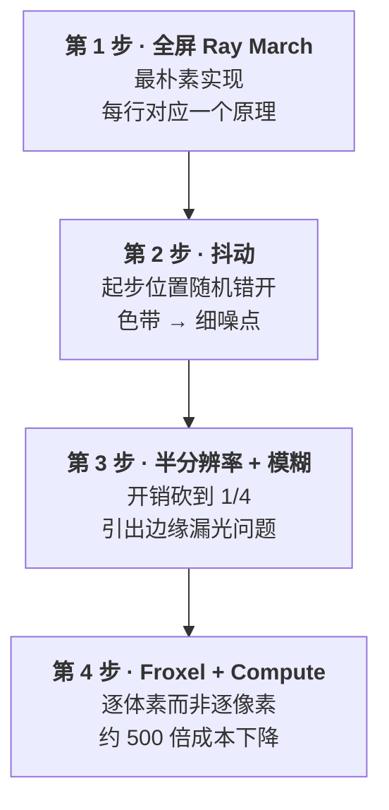

# 体积光：从 Ray Marching 到 Froxel

> 相关笔记：[Froxel](<./Froxel[视锥体素·体积光的加速结构].md>) · [Cluster 与 Z-Binning](<./Cluster与Z-Binning[视锥空间的光源剔除].md>)
>
> 实现部分基于 Unity 6 (6000.0.x) + URP 17，RenderGraph 模式。

**可交互 demo → [在线打开](https://derkder.github.io/Graphics/assets/volumetric-light.html)**（拖滑块看相位函数 / 深度分布 / 色带与抖动 · [源码](../assets/volumetric-light.html)）

---

## 一、光为什么看不见

先说个反直觉的事实：**光本身是看不见的**。

漆黑房间里打开一支激光笔射向对面墙壁 —— 你只能看到墙上那个红点，中间那条"光线"是看不见的。但往空中喷一点烟，那条光路立刻显形。

原因是：眼睛只能看到**射进眼睛里的光**。激光笔的光笔直射向墙，一点也没拐弯进你眼睛。空气里一旦有灰尘、水汽、烟，光打到这些小颗粒上会朝四面八方弹开 —— 这叫**散射（scattering）**。其中一部分正好弹进眼睛，你就"看见"了那段光路。

> **所以体积光渲染的不是光源，也不是被照亮的表面，而是"半路被空气颗粒拐进摄像机的那部分光"。**
>
> 云缝里的光柱、树林里的丁达尔光束、路灯下的锥形光晕，全是同一回事。

---

## 二、最朴素的实现

给屏幕上某个像素算体积光。这个像素对应一条从摄像机射向远方的视线。要问的是：

> **这条射线沿途，一共有多少光被拐进了摄像机？**

沿着射线一步一步往前走，每步问三个问题：

```hlsl
float3 VolumetricLight(float3 camPos, float3 rayDir)
{
    float3 total = 0;
    for (int i = 0; i < 64; ++i)
    {
        float3 p = camPos + rayDir * (i * stepSize);

        float visibility = SampleShadowMap(p);                        // ① 这里被照到吗
        float phase      = HenyeyGreenstein(dot(rayDir, lightDir), g); // ② 光往我这弹多少
        float density    = FogDensity(p);                             // ③ 空气多脏

        total += lightColor * visibility * phase * density;
    }
    return total;
}
```

### ① 能被照到吗 —— 阴影贴图

不用新技术，就是普通 shadow map。渲染阴影时已经从光源角度记录过"每个方向上最近的遮挡物有多远"，拿采样点去查一下就行。

> ⚠️ **这一步是整个效果的灵魂。**
>
> 光柱的形状 **完全** 来自阴影贴图。云缝、树叶缝、窗框，是它们在 shadow map 里挖出的洞决定了光柱长什么样。
>
> **推论**：阴影贴图覆盖不到的东西，永远不会在光柱上留下形状。天上的云不在 shadow map 范围内，所以标准做法里云不会产生丁达尔光束 —— 要那个效果必须额外接一路数据源（比如把 froxel 沿光源方向投影到云层，采样云的不透明度）。

### ② 往哪弹多少 —— 相位函数

散射不是各向均匀的。真实空气里绝大部分光会继续沿原方向往前走一点点（**前向散射**），只有少量往回弹。所以**背对光源时几乎看不到光柱，迎着光看时最明显** —— 逆光拍照那种炫目的雾气感。

最常用的是 **Henyey-Greenstein 相位函数**：

```hlsl
float HenyeyGreenstein(float cosTheta, float g)
{
    float g2 = g * g;
    float denom = 1.0 + g2 - 2.0 * g * cosTheta;
    return (1.0 - g2) / (4.0 * PI * pow(max(denom, 1e-4), 1.5));
}
```

只有一个参数 `g`：越接近 1 越集中在前向，`g = 0` 就是各方向均匀。

`cosTheta = dot(视线方向, 指向光源的方向)`。摄像机正对光源时 ≈ +1，分母最小，散射最强。

<details>
<summary>方向约定的推导（容易搞反）</summary>

物理上，相位函数的自变量是**入射光传播方向**与**出射方向**的夹角。

- 光的传播方向 = `-lightDir`（`lightDir` 是"指向光源"）
- 我们要的出射方向 = `-rayDir`（从采样点回到摄像机）

所以 `cosθ = dot(-lightDir, -rayDir) = dot(lightDir, rayDir)`。

前向散射（g > 0）在 `cosθ = 1` 时最强，也就是 `rayDir` 与 `lightDir` 同向 —— 摄像机正对着光源看。符合直觉。

</details>

> 📌 **注意面板约定**：有些实现会写成 `float g = 1 - _Anisotropic;`，这时面板上的滑条是**反的**（调大 = 更均匀）。看别人代码时留意，两种约定都常见。

### ③ 空气多脏 —— 密度

同样一束光，穿过浓雾和干净空气效果天差地别。最基础版用一个全场均匀的常数；进阶做法会拆成**高度衰减**（雾贴地）+ **噪声**（随风飘动的浓淡）。

---

## 三、完整可运行实现（URP 17 / RenderGraph）

整个效果的核心逻辑只有 **30 行 HLSL**，全在一个 fragment shader 里。

### Shader

```hlsl
Shader "VolumetricLight/SimpleVolumetricLight"
{
    Properties
    {
        _Intensity   ("Intensity",    Float) = 1
        _Density     ("Density",      Float) = 0.02
        _Anisotropy  ("Anisotropy",   Range(-0.95, 0.95)) = 0.6
        _MaxDistance ("Max Distance", Float) = 40
        _StepCount   ("Step Count",   Float) = 32
    }

    SubShader
    {
        Tags { "RenderPipeline" = "UniversalPipeline" }

        Pass
        {
            Name "SimpleVolumetricLight"
            ZWrite Off ZTest Always Blend Off Cull Off

            HLSLPROGRAM
            #pragma vertex   Vert
            #pragma fragment Frag
            #pragma target 3.5

            // ⚠️ 没有这两行，MainLightRealtimeShadow() 会被编译成"永远返回 1"
            #pragma multi_compile _ _MAIN_LIGHT_SHADOWS _MAIN_LIGHT_SHADOWS_CASCADE
            #pragma multi_compile _ _SHADOWS_SOFT

            #include "Packages/com.unity.render-pipelines.universal/ShaderLibrary/Core.hlsl"
            // ⚠️ 必须在 Shadows.hlsl 之前：它用了 LerpWhiteTo 却没自己 include
            #include "Packages/com.unity.render-pipelines.core/ShaderLibrary/CommonMaterial.hlsl"
            #include "Packages/com.unity.render-pipelines.universal/ShaderLibrary/Shadows.hlsl"
            #include "Packages/com.unity.render-pipelines.universal/ShaderLibrary/DeclareDepthTexture.hlsl"

            TEXTURE2D(_BlitTexture);

            float _Intensity, _Density, _Anisotropy, _MaxDistance, _StepCount;

            struct Attributes { uint vertexID : SV_VertexID; };
            struct Varyings   { float4 positionCS : SV_POSITION; float2 texcoord : TEXCOORD0; };

            Varyings Vert(Attributes input)
            {
                Varyings o;
                o.positionCS = GetFullScreenTriangleVertexPosition(input.vertexID);
                o.texcoord   = GetFullScreenTriangleTexCoord(input.vertexID);
                return o;
            }

            float HenyeyGreenstein(float cosTheta, float g)
            {
                float g2 = g * g;
                float denom = 1.0 + g2 - 2.0 * g * cosTheta;
                return (1.0 - g2) / (4.0 * PI * pow(max(denom, 1e-4), 1.5));
            }

            float4 Frag(Varyings input) : SV_Target
            {
                float2 uv = input.texcoord;
                float3 sceneColor = SAMPLE_TEXTURE2D_LOD(_BlitTexture, sampler_LinearClamp, uv, 0).rgb;

                // ① 从深度图反算这个像素看到的表面在世界空间的位置
                float  rawDepth  = SampleSceneDepth(uv);
                float3 surfaceWS = ComputeWorldSpacePosition(uv, rawDepth, UNITY_MATRIX_I_VP);

                // ② 视线方向与长度
                float3 camPos    = _WorldSpaceCameraPos;
                float3 toSurface = surfaceWS - camPos;
                float  dist      = length(toSurface);
                float3 rayDir    = toSurface / max(dist, 1e-5);
                float  rayLength = min(dist, _MaxDistance);

                // ③ 步进，累加"被照亮的路程"
                float stepSize   = rayLength / _StepCount;
                float lightAccum = 0.0;

                [loop]
                for (int i = 0; i < (int)_StepCount; ++i)
                {
                    float3 samplePos = camPos + rayDir * ((i + 0.5) * stepSize);  // 中点法则
                    float4 shadowCoord = TransformWorldToShadowCoord(samplePos);
                    lightAccum += MainLightRealtimeShadow(shadowCoord) * stepSize;
                }

                // ④ 相位函数
                float3 lightDir = normalize(_MainLightPosition.xyz);
                float  phase    = HenyeyGreenstein(dot(rayDir, lightDir), _Anisotropy);

                // ⑤ 组装：光色 × 被照亮的路程 × 密度 × 相位 × 强度
                float3 scattering = _MainLightColor.rgb * lightAccum * _Density * phase * _Intensity;

                return float4(sceneColor + scattering, 1.0);   // 加性，不是乘性
            }
            ENDHLSL
        }
    }
    Fallback Off
}
```

### 几个设计细节

**为什么乘 `stepSize`？**

这不是随手加的系数，是**积分的离散近似**。我们要求的是"沿视线被照亮的路程有多长"，数学上是条线积分，离散化就是"每小段的可见度 × 这小段的长度，全部加起来"。

好处是 `lightAccum` 有明确的物理单位：**米**。于是 `_Density` 的单位是"每米的散射强度"，量纲正确。而且 **改 `stepCount` 时整体亮度不会变**，只有平滑度变 —— 可以放心拿它换性能。

**为什么是 `i + 0.5`？**

取每小段的**中点**而不是端点，中点法则在同样采样次数下误差更小。取端点的话第一个采样点会落在摄像机位置上，纯浪费。

**为什么要 `min(dist, _MaxDistance)`？**

两个理由，第二个容易被忽略：

1. 天空像素的深度是远平面，`dist` 会是几百上千米，按那个长度步进纯属浪费
2. **超出阴影距离后查不到阴影** —— URP 的 Shadow Distance 默认 50 米，超过之后 `MainLightRealtimeShadow` 返回"全亮"，再往前走只会平白攒一堆亮度，画面越远越白

> 所以 `maxDistance` 不要设得比 Shadow Distance 大。

---

## 四、URP 手写 shader 的三个坑

这三个都是真实撞上过的，而且**都不容易靠读文档避开**。

### 坑 1：`undeclared identifier 'LerpWhiteTo'`

```
Shader error: undeclared identifier 'LerpWhiteTo' at .../ShaderLibrary/Shadows.hlsl(327)
```

`LerpWhiteTo` 定义在 `com.unity.render-pipelines.core/ShaderLibrary/CommonMaterial.hlsl`。而 `Shadows.hlsl` 用了它却**没自己 include** —— 因为它默认调用方是 URP 自带的 Lit shader，那条链路走 `Lighting.hlsl` 会顺带带进来。

手写全屏 shader 绕过了那条链路，就得自己补，而且**必须放在 `Shadows.hlsl` 之前**。

### 坑 2：`TEXTURE2D_X` 也没人 include

这个**不会立刻报出来** —— shader 编译器报第一个错就停，修完坑 1 才会撞上。

`TEXTURE2D_X` / `SAMPLE_TEXTURE2D_X_LOD` 是 XR（VR 单趟渲双眼）专用宏，只定义在 `TextureXR.hlsl` 里，`Core.hlsl` 这条链路不包含它。

不做 XR 的话，直接用普通的 `TEXTURE2D` / `SAMPLE_TEXTURE2D_LOD` 最省事，顺带能把 stereo 宏也删掉。

> **可复用的经验**：URP 的 ShaderLibrary **大量存在"假设调用方已经引过某个头文件"的隐式依赖**。手写 shader 时这类错误只有真编译一次才暴露，而且一次只报一个，得一轮一轮修。
>
> 省事的办法：动手前先 grep 一下要用的每个符号定义在哪个文件、谁 include 了它。比来回编译快得多。

### 坑 3：忘记 `multi_compile`，效果**静默失效**

最阴险，因为**不报任何错**。

```hlsl
// URP Shadows.hlsl
half MainLightRealtimeShadow(float4 shadowCoord)
{
    #if !defined(MAIN_LIGHT_CALCULATE_SHADOWS)
        return half(1.0);      // ← 关键字没开 → 永远"被照到"
    #endif
    ...
}
```

症状：屏幕糊上一层均匀白雾、完全没有光柱。

**看到这个症状，先查 `multi_compile`。**

同类问题还有 `ConfigureInput(ScriptableRenderPassInput.Depth)` —— URP 默认不生成深度图（省性能），没人申报就没有。忘了写，`SampleSceneDepth` 读到空图，同样是均匀白雾 + 零报错。

---

## 五、RenderGraph 接线

Unity 6 的 URP 默认关闭 Compatibility Mode，必须走 `RecordRenderGraph`。

**老 API 是"边说边做"，RenderGraph 是"先交计划，再统一施工"。**

```csharp
public override void RecordRenderGraph(RenderGraph renderGraph, ContextContainer frameData)
{
    var resourceData = frameData.Get<UniversalResourceData>();
    if (resourceData.isActiveTargetBackBuffer) return;

    // 一张纹理不能同时被读和被写，所以另开一张作为输出
    var desc = renderGraph.GetTextureDesc(resourceData.cameraColor);
    desc.name = "_SimpleVolumetricLightTarget";
    desc.clearBuffer = false;
    TextureHandle destination = renderGraph.CreateTexture(desc);

    using (var builder = renderGraph.AddRasterRenderPass<PassData>(
               "Simple Volumetric Light", out var passData, s_Sampler))
    {
        passData.material = m_Material;
        passData.source   = resourceData.cameraColor;
        passData.settings = m_Settings;

        builder.UseTexture(passData.source, AccessFlags.Read);
        builder.SetRenderAttachment(destination, 0, AccessFlags.Write);
        builder.UseAllGlobalTextures(true);   // _CameraDepthTexture / _MainLightShadowmapTexture

        builder.SetRenderFunc((PassData data, RasterGraphContext ctx) => ExecutePass(data, ctx));
    }

    resourceData.cameraColor = destination;   // ⚠️ 告诉后面的 pass：画面换人了
}
```

### 为什么要这么写

引擎拿到整帧的依赖图之后能干三件你手动做不到的事：

1. **显存复用（aliasing）** —— 生命周期不重叠的纹理共用同一块显存
2. **剔除没人要的 pass** —— 算了但没人读的 pass 会被整个删掉（所以才有 `builder.AllowPassCulling(false)` 这个 API）
3. **移动端 tile 内存合并** —— 见下一节，这是最值钱的一条

### 三条反直觉的规则

**规则一：`PassData` 不是可有可无的样板。**

`SetRenderFunc` 注册的函数**要等一会儿才跑**，中间引擎重排了顺序、合并了 pass。执行时你 `RecordRenderGraph` 里的局部变量、甚至 `this` 的状态都可能变了。

所以：**执行时需要的一切，必须提前塞进 PassData**。上面那个 lambda 只用了参数传进来的 `data` 和 `ctx`，一个外部变量都没捕获 —— 这是对的写法。

**规则二：`UseTexture` 不是"读取"，是"报备"。**

它不搬任何数据，只是在申报表上打勾。漏报的后果不是"读到空数据"，而是引擎认为这张纹理没人用把显存分给别人了，或者认为你的 pass 无关紧要直接剔掉。**症状是效果莫名不出现，且零报错。**

`UseAllGlobalTextures(true)` 同理 —— 全局纹理不走 RenderGraph 的句柄系统，图里追踪不到，得显式声明。

**规则三：不能原地改画面。**

GPU 不允许同一张纹理既当输入采样又当渲染目标。流程只能是 `读 A → 写 B → 宣布 B 才是新的 cameraColor`。

最后那句 `resourceData.cameraColor = destination` 是最容易漏、漏了最难查的一行 —— 效果算了但完全看不见，而且大概率还会被规则二的剔除机制干掉，连 GPU 时间都不花。

<details>
<summary>一个 C# 的坑：隐式转换不能链式</summary>

`TextureHandle` 有到 `RTHandle` 的隐式转换，`RTHandle` 又有到 `Texture` 的隐式转换。但 **C# 不会自动串联两次用户定义的隐式转换**，所以 `SetTexture(id, textureHandle)` 编译不过。必须中转一次：

```csharp
RTHandle source = data.source;                       // 第一次：TextureHandle → RTHandle
s_PropertyBlock.SetTexture(s_BlitTextureId, source); // 第二次：RTHandle → Texture
```

URP 自己的 `FullScreenPassRendererFeature` 也是这么绕的（通过方法参数类型完成第一次转换）。

</details>

---

## 六、移动端视角：为什么全屏 pass 这么贵

移动 GPU 是 **tile-based** 架构：把屏幕切成小块，一块一块渲染，中间结果存在片上的高速 tile 内存里，画完才往主显存写一次。

**从主显存取一次数据的能耗，大约是从片上内存取一次的 100 倍量级。**

一张 1080p RGBA8 是 8.3 MB。我们这个 pass 读一张写一张：

```
读 cameraColor:  ≈ 8.3 MB
写新的 target:   ≈ 8.3 MB
                 ──────────
每帧多搬          ≈ 16.6 MB
```

而且中途"读回已画好的画面"这个动作，会强制打断分块流水线：所有 tile 的结果先 **Store** 到主显存，再作为普通纹理 **Load** 回来。

> **移动端"少用全屏后处理"这条经验法则，根源不是算得多，是搬得多。**

这也正是 RenderGraph 存在的意义之一：如果引擎提前知道"pass B 紧接着就要逐像素读 pass A 的输出"，可以把两者合并成同一个原生 render pass 的两个 subpass，中间结果**根本不出 tile 内存**（Vulkan 的 subpass / GLES 的 framebuffer fetch）。这个优化必须看到全帧结构才能做。

<details>
<summary>顺带记几条 tile-based 的反直觉结论</summary>

- **MSAA 在移动端几乎免费**：多重采样只存在于 tile 内存，resolve 在片上完成，只把合并后的单份结果写出去。主显存带宽零增加。**这和桌面 IMR 的经验完全相反。**
- **不清空缓冲反而更慢**：`Clear` 是免费的，但"不清空"意味着 GPU 必须把上一帧内容 `Load` 进来。为了省一次免费的 Clear，换来一次全屏 Load。
- **深度缓冲用完要标 `DontCare`**：否则会被写回主显存，而下一帧根本不会用到。
- **部分移动 GPU 上 overdraw 几乎免费**：TBDR 架构（PowerVR / Apple）会先把 tile 内所有几何的深度关系算清楚，只对最终可见的片元跑着色器。而 TBR（如 Mali）没有完整的 HSR，**从前往后排序绘制仍然有明显收益**。

</details>

---

## 七、算一笔账：为什么必须优化

1080p、每像素 32 步：

```
1920 × 1080 × 32 = 66,355,200 次
```

每次还包含一次 shadow map 查询。而且**没有任何像素能提前逃掉** —— 打在近处物体上的像素只是步长变短，循环照样跑满 32 次。

降步数行不行？降到 8 步，光柱里会出现明显的一层层**色带（banding）**，因为采样太稀，光柱边缘变成了台阶。

---

## 八、优化路线图



| 步骤 | 解决什么 | 关键点 |
|---|---|---|
| **抖动（dithering）** | banding | 让每像素起步位置随机错开一点，把规律色带打散成细噪点。**人眼对噪点的容忍度远高于对规律条纹的容忍度。** 改动只有两三行，效果反差极大 |
| **半分辨率 + 模糊** | 性能 | 只在 1/2 分辨率上算再糊回全屏。会引出新问题（物体边缘漏光），正好引出双边滤波 |
| **Froxel** | 移动端 | 见 [Froxel 笔记](<./Froxel[视锥体素·体积光的加速结构].md>)。不再按像素算，按体素算 |

> **建议按顺序走一遍。** 先亲眼看见色带，抖动那两三行代码才有分量；先亲手体验一次"降低计算分辨率再糊回来"，才能理解 froxel 在横向做的是同一件事、只是推到了极致还顺便把深度方向也管了。

### 这一版故意没做的

| 没做 | 后果 |
|---|---|
| 抖动 / 蓝噪声 | 低 stepCount 下有明显色带 |
| 降分辨率 | 全分辨率逐像素步进，很贵 |
| 时域累积（TAA 复用） | 省不到帧间的相关性 |
| 非均匀密度（高度雾 / 噪声） | 空气是一块死板的均匀介质 |
| 额外光源（点光 / 聚光） | 只有主光能产生体积光 |
| 透射率的指数衰减 | 物理上不准（远处该更暗）。很多商业项目也没做 |

---

## 九、参数与调试

| 参数 | 典型值 | 说明 |
|---|---|---|
| `stepCount` | 32 | 改它**不影响整体亮度**，只影响平滑度（因为乘了 stepSize） |
| `intensity` | 1.0 | 整体倍率 |
| `density` | 0.02 | 空气密度（每米），调大整体发白 |
| `anisotropy` | 0.6 | 就是 HG 的 g，>0 前向散射 |
| `maxDistance` | 40 | 步进上限，**别超过 Shadow Distance** |

### 四个值得亲手做的实验

按"最能建立直觉"排序：

1. **`anisotropy` 0.6 → 0** —— 迎光和背光变得一样亮，画面立刻变"平"、变假。这条最能体会相位函数在干什么
2. **`stepCount` 32 → 8** —— 光柱里出现一层层色带。**先看见问题，再谈优化**
3. **相机转 180° 背对光源** —— 光柱基本消失。不是 bug，见下面的数字
4. **`intensity` → 0** —— 对照组，分不清"这现象是不是体积光造成的"时用它

### 一个具体的数字例子

参数取默认值，场景是一排带缝隙的柱子 + 低角度太阳，相机迎光。

**像素 A —— 打在缝隙里（看到远处天空）**

```
rayLength = min(1000, 40) = 40      stepSize = 40/32 = 1.25 米
32 步里假设 20 步被照到 → lightAccum = 20 × 1.25 = 25 米

cosθ ≈ 0.99, g = 0.6：
  denom = 1 + 0.36 − 2×0.6×0.99 = 0.172
  phase = 0.64 / (4π × 0.172^1.5) = 0.714

scattering = 光色 × 25 × 0.02 × 0.714 × 1 = 光色 × 0.357
```

**像素 B —— 打在正对太阳那根柱子上**

```
rayLength = 14 米                    stepSize = 14/32 = 0.4375 米
整条视线躲在柱子自己的影子里，假设只有 3 步是亮的
  → lightAccum = 3 × 0.4375 = 1.31 米

scattering = 光色 × 1.31 × 0.02 × 0.714 × 1 = 光色 × 0.019
```

**相差约 19 倍 —— 这个亮度落差就是你看到的"光柱"。** 它不是画上去的，是算出来的：缝隙里的空气被照到，柱子后面的空气没被照到，仅此而已。

**再把相机转过来背对光源：**

```
cosθ 从 +0.99 变成 −0.99：
  denom = 1 + 0.36 + 1.188 = 2.548
  phase = 0.64 / (4π × 2.548^1.5) = 0.0125

对比迎光时的 0.714 —— 暗了 57 倍
```

> **一个有意思的观察**：如果场景里有一根柱子正对着光源，它看起来会比旁边的柱子暗很多。
>
> 原因不是它被"剪影化"了，而是：**旁边的柱子前方有被照亮的空气把它们"洗白"了，而正对光源那根的整条视线都泡在自己的影子里，`lightAccum ≈ 0`，没有雾气叠加，所以保留了本色。**
>
> 换句话说，那个"看起来不对劲"的柱子，恰恰是体积光正确工作的直接证据。

### 调试手段

- **`Window → Analysis → Frame Debugger`** —— 找到自己的 pass，看输入输出，点前后两步对比"加了多少光"
- **`Window → Analysis → Render Graph Viewer`** —— 看整帧的依赖图：谁读谁写、哪些资源共用了显存、哪些 pass 被合并了
- **真机抓帧** —— 桌面 IMR 看不出 Load/Store 的代价。Snapdragon Profiler（Adreno）/ Arm Performance Studio（Mali）能直接看到每个 render pass 的 Load/Store action 和实际带宽；Xcode GPU Frame Capture 会标出哪些 pass 被合并了

---

## 十、一句话总结

**体积光 = 沿视线切成很多小段 → 每段问"这里被光照到吗、光会往我这边弹多少、这里空气多脏" → 加起来 → 叠到画面上。**

朴素实现每行代码都对得上原理，但每像素每步的乘法注定跑不动。所有后续优化都在砍这个乘法的两个因子：**抖动**让"每步"可以更少，**降分辨率**让"每像素"变少，而 [**Froxel**](<./Froxel[视锥体素·体积光的加速结构].md>) 把两个因子一起换掉 —— 不再按视线组织计算，改按空间组织。
