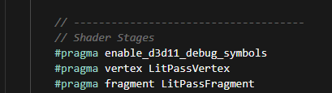
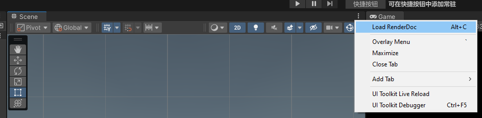
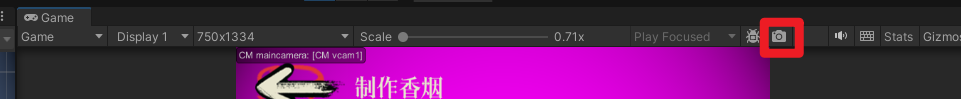
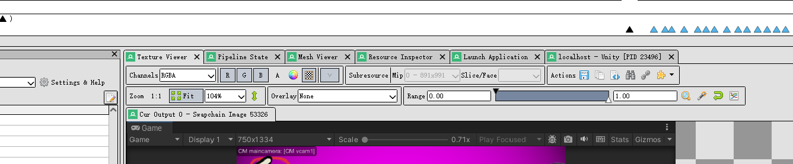
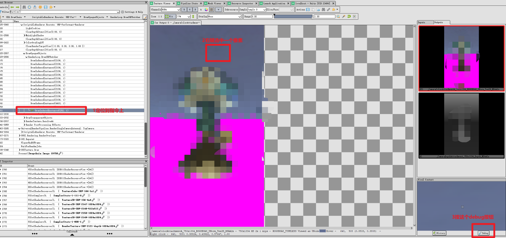
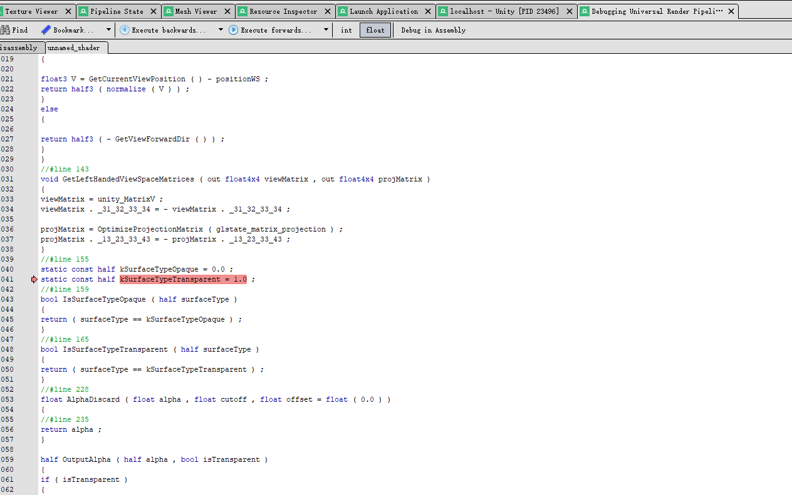
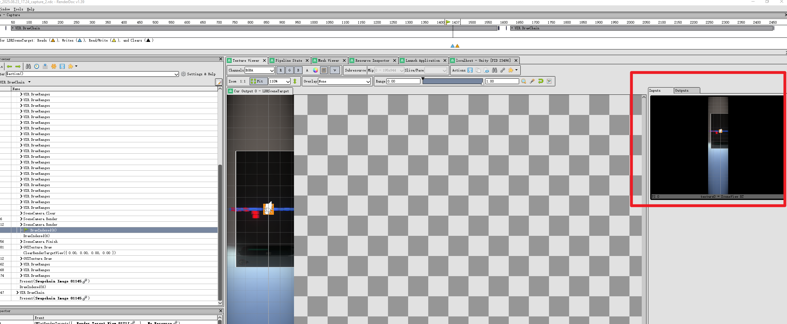

## RenderDoc
### step1 在shader中加入一行：#pragma enable_d3d11_debug_symbols
   
不加的会shader显示的就不是正常语言了，是类似于汇编语言的一个东西

### step2 

### step3   

### step4 首先去textureview

定位到drawcall上！（否则没办法debug像素点）
  

### step5 刚刚debug之后会跳到这里
 
F10 跳到下一步   Shift + F10 跳到上一步
F11 跳到函数里去  Shift + F10回退

-------

### tips1：有的时候会发生在game下截帧，其实截帧到了scene窗口，这样的话其实是两个窗口反过来了，所以截scene就可以了   
### tips2：这里可以看到每个阶段的输入输出贴图，感觉比framedebugger的准